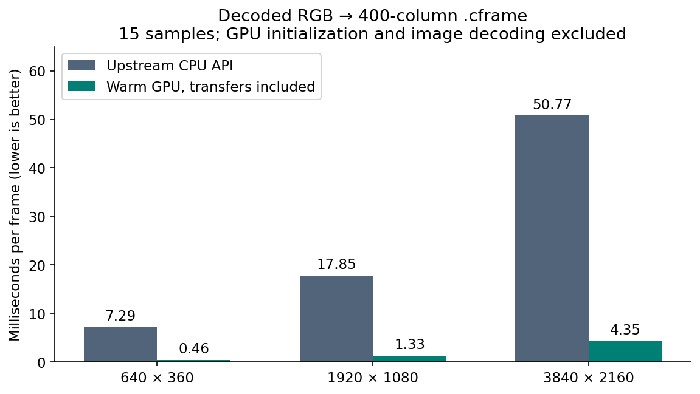
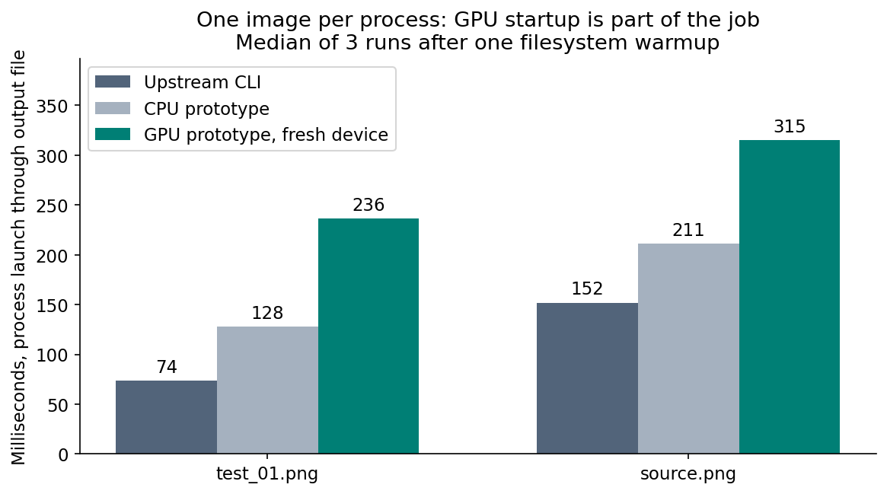
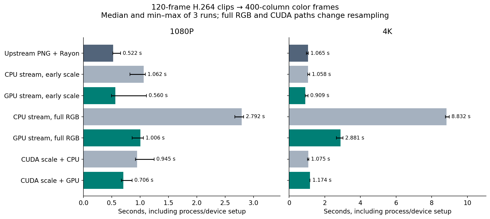

# A 13× faster frame converter did not make my ASCII video pipeline 13× faster

*Technical article draft — measurements from 10 November 2026. Tested on an RTX 2080 SUPER and Core i9-9900K. Companion code, complete methodology, and raw data: [investigation report](REPORT.md).*

Moving a frame conversion pipeline onto the GPU produced an encouraging result: a decoded 1080p image became a 400-column color ASCII frame in **1.33 milliseconds**, compared with **17.85 milliseconds** through cascii's CPU API. That is a 13.38× improvement, including upload and readback.

Then I measured a video.

The existing application converted a four-second 1080p clip in 0.522 seconds. The closest GPU streaming replacement took 0.560 seconds. The large improvement inside the frame converter had not translated into an end-to-end win on that clip.

Understanding that difference was the useful part of the experiment.

## Start with the pipeline the application actually runs

[cascii](https://github.com/cascii/cascii/tree/f664097be9e7f46b7d73e00eef14cc4848fd95ed) is a Rust image/video-to-ASCII converter. I investigated version 0.33.0 at commit `f664097`. The default foreground-only image path is straightforward:

1. Decode and obtain RGB pixels.
2. Resize to the character grid using a triangle filter.
3. Compute brightness and select a character from a ramp.
4. Write text or a color frame.

A color frame stores an eight-byte dimensions header followed by one character byte and three RGB bytes for each cell. The brightness calculation uses integer coefficients:

```text
luma = (2126*R + 7152*G + 722*B) / 10000
```

Values below the threshold become spaces. Values above it select an index in the configured character ramp. Each cell is independent, making the mapping easy to parallelize.

However, the video command does something important before that Rust code runs: **FFmpeg already reduces the frame width**. At 400 columns, the extraction filter is `scale=400:-2,fps=30`. A 16:9 video becomes a sequence of 400×226 PNGs. Cascii adjusts their height to 158 rows for the default font ratio and converts them using Rayon.

The CPU image API can receive millions of pixels. The normal video conversion stage receives a much smaller image. Those are different optimization opportunities.

## Build a GPU experiment with visible transfer costs

I built an isolated Rust executable using wgpu and WGSL, running through Vulkan on the NVIDIA GPU. It does not modify the upstream CLI or add a production GPU feature.

The prototype uses two compute passes. The first applies the vertical triangle filter into an intermediate floating-point buffer. The second performs horizontal filtering, rounds RGB, selects the ASCII character, and writes the packed color cell. Buffers and pipelines stay alive across frames of the same dimensions.

Downsampling matters here. A triangle resampler widens its support as the source-to-destination ratio increases. Replacing it with a convenient four-texel bilinear lookup would not preserve the same filtering behavior. I followed the separable structure in `image` 0.25.10 and checked the output against cascii.

I measured wall time around the full GPU conversion call: upload, dispatch, completion wait, readback, and constructing the returned bytes. This is not a GPU-timestamp-only kernel result. Image decoding and initial device setup are excluded from this particular experiment and measured separately.

The CPU baseline uses cascii's real `image_to_frame(...).cframe_bytes()` API. That API creates text and RGB data before serialization; the shader directly emits packed cells. The gain therefore includes fewer intermediate allocations and serialization steps, as well as GPU execution. It is a useful pipeline comparison, not a claim that identical arithmetic alone became 13× faster.

## The warm-frame result is real—and scoped

At 400 output columns:

| Decoded input | CPU | GPU, including transfers | Ratio |
|---|---:|---:|---:|
| 640×360 synthetic image | 7.29 ms | 0.46 ms | 15.91× |
| 1920×1080 synthetic image | 17.85 ms | 1.33 ms | 13.38× |
| 3840×2160 synthetic image | 50.77 ms | 4.35 ms | 11.67× |



Each value is the median of 15 samples after three warmups, with CPU/GPU execution order alternating. I also tested the repository's five PNG fixtures at 80, 400, and 1000 columns. The GPU won all 24 warm cases, but those are repeated decoded-image operations on one workstation. The largest ratios include upscaling and are not representative video speedups.

Output fidelity also needs a number. Across those cases, RGB channels differed by at most one 8-bit level. The largest character mismatch rate was 0.103%. A tiny RGB rounding difference can change integer brightness enough to cross a character-ramp boundary.

That is close, but not byte-identical. If exact reproducibility is part of the product contract, it needs an explicit CPU fallback or a more tightly controlled numeric implementation. “Looks similar” is not the same test as “produces the same file.”

## Three padding bytes exposed a full-image copy

An early result looked suspicious: some similarly sized PNGs were much slower on the GPU than others.

The distinguishing feature was their raw RGB byte length. Queue uploads require suitable alignment. My initial implementation handled a trailing one to three bytes by cloning the whole image and padding the clone.

That meant allocating and copying megabytes to solve a three-byte problem.

I changed the upload to send the aligned prefix directly, followed by a four-byte tail buffer. At 400 columns, `source.png` improved from 14.24 ms to 4.00 ms. Two other unaligned inputs improved from 8.88 to 2.91 ms and 9.40 to 3.07 ms. These were successive benchmark runs, so the exact ratios deserve that qualification, but the avoidable copy was clear in the code.

GPU optimization still involves ordinary host-side allocation and data movement. A fast shader cannot recover time spent copying its input unnecessarily.

## A fresh GPU device changes the answer

The final warm-frame run recorded roughly 132 ms of device and pipeline initialization. That overhead is excluded from the frame table, but a one-image command has to pay it.

With process launch, image decoding, setup, conversion, and output included, the existing CLI converted `test_01.png` in 74 ms. The GPU prototype took 236 ms. For the larger `source.png`, the comparison was 152 ms versus 315 ms.



This suggests a useful deployment distinction. A persistent editor, preview session, or batch can amortize initialization. A short-lived command converting one image often cannot. The experiment supports a reusable GPU session, rather than automatically creating a device for every invocation.

## Video performance is governed by more than the converter

I generated two four-second H.264 motion clips, at 1080p and 4K, with 120 frames each. Every pipeline wrote 400×158 color frames. Video figures are medians of three measured runs after one warmup; process startup and output writes are included.



There are three comparisons worth separating.

**Full-resolution RGB through a pipe.** GPU conversion beat the matching CPU prototype: 1.006 versus 2.792 seconds at 1080p, and 2.881 versus 8.832 seconds at 4K. But both GPU results were slower than upstream's early-downscale pipeline. The 4K raw pipe alone carries almost three gigabytes for 120 frames. The CPU prototype is also sequential and copies input to use the public image API, so it is not the strongest CPU implementation available.

**Preserving FFmpeg's early scale.** This is the closer replacement. The CPU streaming version produced byte-identical output to upstream for all 120 frames of both clips. The GPU version had very small sampled differences: at most one RGB level, with character mismatch rates below 0.0013% on five sampled frames per clip. Its 1080p median was slightly slower than upstream. At 4K it took 0.909 seconds versus 1.065 seconds, about 1.17× faster by median—but the observed timing ranges overlapped. More repetitions and longer clips are needed before treating that as a dependable win.

**CUDA decode and scale.** This worked, but it did not beat upstream in these tests. The pipeline downloaded resized NV12 to the host, converted it to RGB, and optionally uploaded it again to Vulkan. That is not a resident GPU pipeline. Its bilinear scaling and color-processing path also changed around 9–10% of sampled ASCII characters relative to upstream, so it cannot be presented as an equivalent-output optimization.

The existing application benefits from early work reduction and parallel frame conversion. A sequential pipe removes PNG files, but also gives up some of those scheduling advantages. Fewer intermediate files do not automatically mean lower wall time.

## The heavier opportunity is glyph fitting

Cascii also supports fitting a foreground color, background color, and glyph mask to each cell. Instead of calculating one brightness value, this path evaluates many candidates over a patch of pixels and chooses the smallest reconstruction error.

At 400 columns on `test_01.png`, the existing legacy CPU fitter took 2.59 seconds. The existing optimized CPU implementation took 1.13 seconds, with identical output. For context, foreground-only conversion took about 71 ms, although that produces a different visual result.

This is a stronger compute-shader candidate: many independent cells, repeated glyph masks, and substantial arithmetic per patch. A plausible implementation would load patch pixels into workgroup memory, reuse a glyph atlas, compute weighted sums, and reduce candidate errors with deterministic tie-breaking.

It is also a more difficult port. The CPU fitter uses f64, while a straightforward WGSL implementation uses f32. Near-equal errors can change the selected glyph; rounding can change fitted colors. A future implementation should validate reconstruction quality, threshold behavior, ties, and temporal stability, potentially rechecking ambiguous cells on the CPU. **No GPU background-fitting speedup was measured in this investigation.**

## What I would implement next

The first integration would be an optional persistent GPU session for repeated foreground frame conversions, with CPU fallback and a documented fidelity policy. I would reuse one source upload across multiple requested sizes and overlap uploads, dispatches, and readbacks with a bounded buffer ring.

The next experiment would target background fitting. Its CPU cost and arithmetic structure justify investigation, but its numeric behavior deserves tests before speed claims.

For videos, I would preserve early scaling and frame concurrency while examining a genuinely resident path. Decoding on the GPU, downloading to a pipe, and uploading again is not the same design as sharing GPU surfaces across decode, compute, render, and encode.

Encoding also exposed a practical compatibility issue. Although this machine's CUDA decode path worked, the installed FFmpeg required NVENC API 13.0 and found 12.2 in the driver. I recorded the failure rather than reporting an encoding speedup or changing the machine's driver. NVIDIA's [FFmpeg integration guide](https://docs.nvidia.com/video-technologies/video-codec-sdk/13.0/ffmpeg-with-nvidia-gpu/index.html) makes driver/build compatibility part of that workflow.

The useful outcome is a set of boundaries: a strong warm-frame gain, a cold-start penalty, a video pipeline that already avoids expensive work, and a heavier fitting algorithm worth tackling next. A fast inner operation becomes an application improvement only when the application actually spends enough time doing that operation.

---

**Reproduction and publication notes:** The [report](REPORT.md) links the code, raw samples, exact commands, fixture hashes, quality comparisons, and PNG/SVG figures. The hardware was an active Windows desktop, not an isolated benchmark host. Video coverage is two synthetic clips; this draft makes no claims about general footage, perceptual quality, energy, or other GPUs. The GPU prototype is experimental and is not merged into upstream cascii. Keep those qualifications alongside the charts when editing this article.
