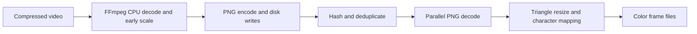
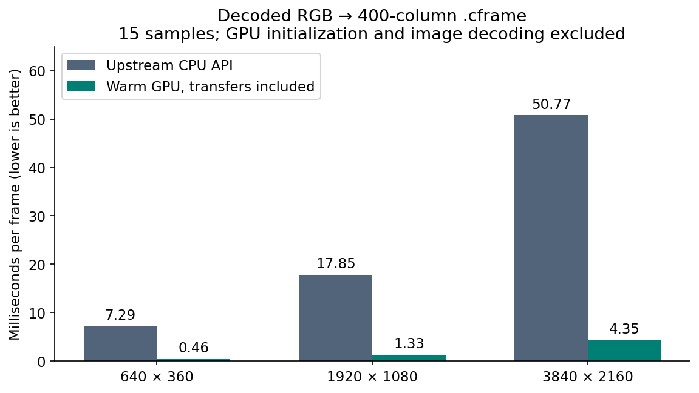
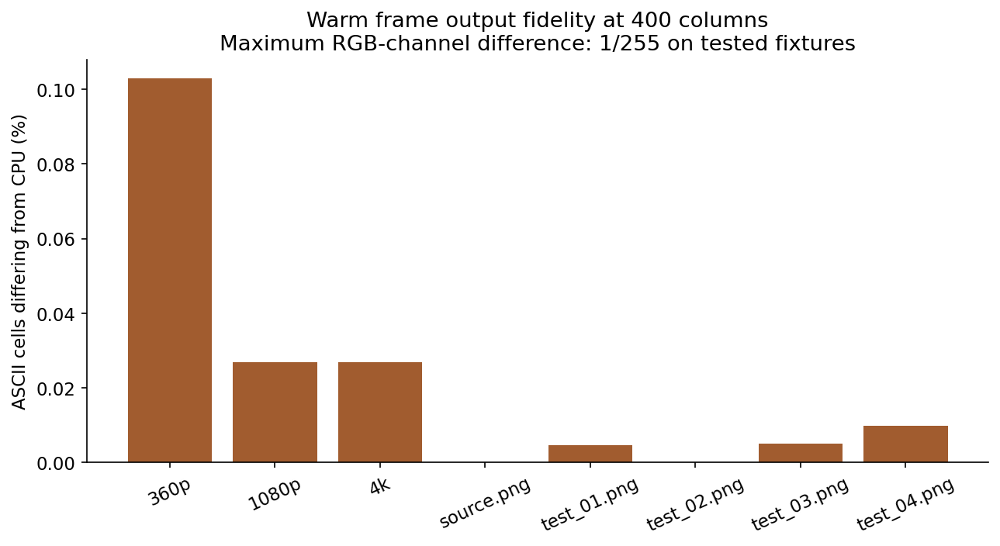
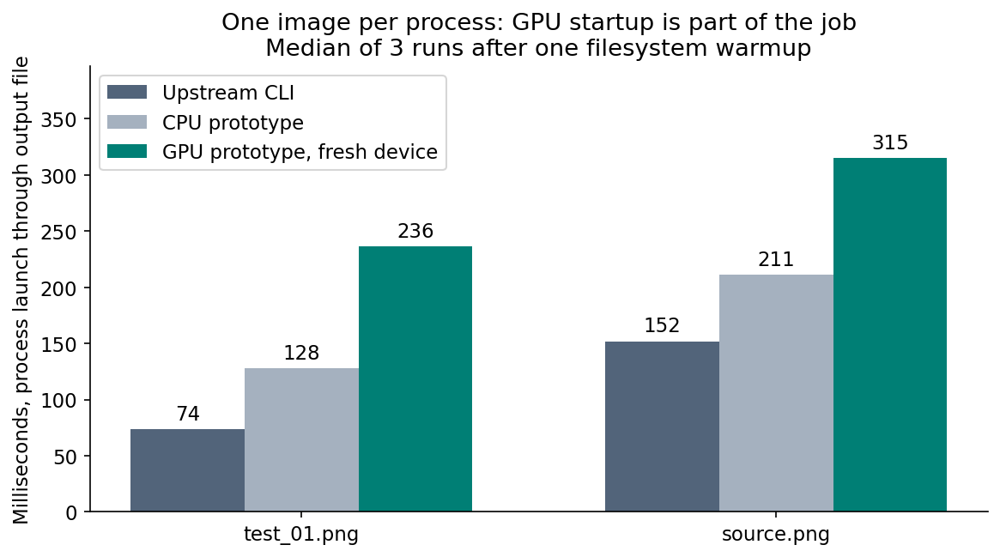
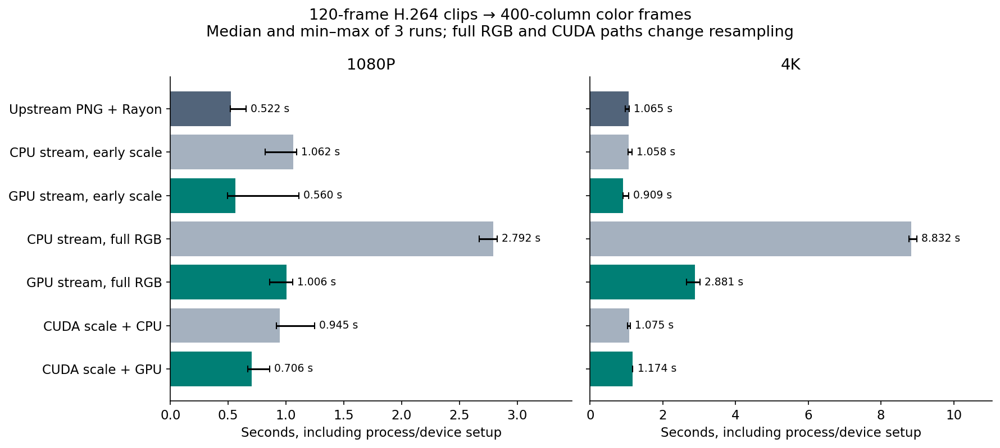

# cascii GPU acceleration investigation

**Measured locally on 10 November 2026.** Repository: [cascii/cascii](https://github.com/cascii/cascii), version 0.33.0, commit [`f664097be9e7f46b7d73e00eef14cc4848fd95ed`](https://github.com/cascii/cascii/tree/f664097be9e7f46b7d73e00eef14cc4848fd95ed). Checkout: `D:\Desktop\cascii`, branch `research/gpu-investigation`.

## Findings that should guide implementation

The GPU substantially accelerates the **warm, decoded-frame conversion pipeline**. At 400 columns, the prototype took 1.334 ms versus 17.847 ms for the CPU API on a synthetic 1080p image: **13.38× faster**. On synthetic 4K, the corresponding numbers were 4.351 ms and 50.768 ms: **11.67× faster**. These timings include GPU uploads, execution, synchronization, readback, and materializing `.cframe` bytes. They exclude image decoding and device initialization.

This does **not** establish a comparable speedup for cascii's existing video command. Upstream downsizes before saving frames and uses Rayon for conversion. On a four-second 1080p clip, upstream took 0.522 s; the closest GPU streaming replacement took 0.560 s. On 4K, the same comparison was 1.065 s versus 0.909 s, a **1.17× median ratio with overlapping observed ranges**. That small difference needs more runs and longer, varied clips before making a performance guarantee.

Single-image jobs favor the existing CPU CLI because startup matters. The GPU prototype took 236 ms versus 74 ms for `test_01.png`, and 315 ms versus 152 ms for `source.png`, including process launch, decode, initialization, conversion, and output.

The most promising unimplemented compute target is **foreground/background glyph fitting**, followed by keeping resized frames and glyph rendering on the device. CUDA decoding/scaling worked on this machine. NVENC encoding did not: the installed FFmpeg requires NVENC API 13.0, while the driver exposes 12.2. No driver or system FFmpeg changes were made.

## Deliverables and scope

- [Runnable Rust/WGSL prototype](gpu-bench/): GPU triangle resize, integer luminance/ramp selection, packed color-frame output, CPU comparison, streaming video experiments, and output checks.
- [Benchmark runner](run_benchmarks.py), [fixture generator](make-fixtures.ps1), [artifact verification](verify_artifacts.py), and [plot generator](plot_results.py).
- [Raw frame samples](results/frames.json), [video samples and commands](results/videos.json), [video summary](results/video_summary.json), [cold-image samples](results/images.json), and [fitter samples](results/fitters.json).
- [Hardware/toolchain record](results/environment.json), [fixture hashes](results/fixtures.json), and [output verification](results/artifact-verification.json).
- [Technical blog draft](BLOG_DRAFT.md) and four figures in both PNG and SVG under [figures/](figures/).

The upstream source and root Cargo manifest/lockfile remain unchanged. The GPU implementation is an isolated research executable, **not a production `--gpu` feature**. Only foreground color output is implemented on the GPU; background fitting and video rendering remain proposed extensions. The prototype uses a persistent device within a job, but processes frames synchronously with one readback in flight. It selects Vulkan and rejects a CPU software adapter. It is not a tested browser, Metal, DirectX, or CUDA-interoperability implementation.

## Local environment

| Component | Recorded configuration |
|---|---|
| CPU | Intel Core i9-9900K, 8 cores / 16 logical processors |
| GPU | NVIDIA GeForce RTX 2080 SUPER, 8 GiB VRAM |
| GPU driver | 566.36, Windows WDDM; prototype adapter reports Vulkan |
| Memory | 34,265,489,408 bytes reported by Windows, approximately 32 GiB |
| OS | Windows 10 Pro, build 19045 |
| Rust | rustc 1.90.0, x86_64-pc-windows-msvc, LLVM 20.1.8 |
| FFmpeg | 8.0 full Gyan build |
| Build | Release, thin LTO, one codegen unit; root built with `--locked` |
| Prototype | wgpu 0.19.4, WGSL; separate Cargo.lock saved with the prototype |
| Filesystem | Desktop resolves to `D:\Desktop`; D: is an approximately 8 TB NTFS volume |

The wgpu version is an explicitly pinned experimental dependency, not a recommendation that it is the latest version. No CUDA toolkit was installed. The existing driver supplies Vulkan and the FFmpeg build contains CUDA support. This was an active desktop, with other applications open; clocks, thermal state, OS caches, antivirus activity, and competing work were not controlled. Storage model/RAID topology for D: was not conclusively mapped. These are workstation observations, not controlled lab results or energy measurements.

## Source investigation

### Default image and video paths

The core conversion is in [`src/frame.rs`](../src/frame.rs): RGB conversion, exact-dimension triangle resizing, integer luminance, character selection, and text/RGB output. The `.cframe` serializer subsequently interleaves one ASCII byte and three RGB bytes per cell after an eight-byte dimensions header. The GPU directly produces the packed cell payload, eliminating that intermediate string/serialization work as well as moving the resize and mapping to the GPU. Therefore the measured gain is a **pipeline improvement**, not an isolated arithmetic-kernel comparison.

The character mapping is:

```text
luma = floor((2126*R + 7152*G + 722*B) / 10000)
if luma < threshold: character = space
else: index = floor((luma-threshold)*(ramp_length-1) / max(255-threshold,1))
```

This is the existing integer brightness convention applied to stored RGB values. No linear-light color conversion was introduced.

[`src/preprocessing.rs`](../src/preprocessing.rs) constructs `scale=columns:-2,fps=fps`. [`src/video.rs`](../src/video.rs) invokes FFmpeg to write PNGs. [`src/convert.rs`](../src/convert.rs) hashes input files for duplicate detection, converts representatives using Rayon, and copies duplicate outputs. For a 16:9 input at 400 columns, FFmpeg emits 400×226 images; cascii then adjusts these to 400×158 character cells with the default 0.7 font ratio.



Two implications follow. First, a shader that only maps the already-small final grid cannot capture the apparent full-resolution resize opportunity. Second, replacing PNGs with a raw pipe also changes scheduling: this prototype's sequential conversion loses upstream frame parallelism and duplicate reuse. Removing intermediate files by itself is not proven faster here.

### Background fitting

[`src/render.rs`](../src/render.rs) and [`src/background_fit_optimized.rs`](../src/background_fit_optimized.rs) resize to a glyph-analysis grid, gather each cell's pixels, and evaluate candidate glyph masks. Each candidate solves for foreground and background colors using precomputed mask sums, then compares reconstruction error. The optimized implementation caches glyph data, skips zero-alpha contributions, and parallelizes rows; it already exists upstream.

Work grows approximately with `cells × candidate glyphs × pixels per analysis cell`. This provides substantially more arithmetic per cell than the foreground-only ramp. The fidelity/fast settings use analysis font sizes 16/7 and change the workload and potentially its output. This investigation kept fidelity for fitter comparisons.

### Rendering, multisize, and other operations

[`src/render.rs`](../src/render.rs) blends glyph masks into RGB frames on the CPU. The encoder path explicitly selects `libx264`, `medium`, and CRF. A GPU glyph-atlas renderer is parallel across output pixels, but reading every rendered RGB frame back for CPU encoding could erase much of its advantage. An integrated GPU-render-to-hardware-encoder design is the stronger hypothesis.

[`src/multisize_io.rs`](../src/multisize_io.rs) already decodes once for multiple requested sizes; [`src/frame.rs`](../src/frame.rs) still clones RGB storage for each in-memory size. A persistent GPU upload reused across independent output-size dispatches is attractive. Each size should still be sampled from the original, since repeatedly downsizing the previous result changes filtering.

[`src/loop_detect.rs`](../src/loop_detect.rs) already uses hashing, a 64-cell quick comparison, caching, and Rayon across candidate periods. A GPU distance-reduction kernel is plausible only for large resident batches after these CPU rejection stages. File scans, archive layout, metadata, and audio extraction are low-priority targets for a compute shader. Cell filters and color shifts are better fused with a GPU pipeline than dispatched as separate tiny jobs.

One unrelated reliability issue merits follow-up: `extract_video_frames_with_progress` pipes FFmpeg progress output, but its waiting helper does not drain that pipe. A long extraction could block when the pipe fills. This is a source-inspection concern, not a reproduced failure in these short benchmarks; any streaming integration should drain diagnostics/progress and propagate cancellation/errors.

## GPU implementation and an optimization found during testing

The prototype mirrors `image` 0.25.10's separable triangle-resampling structure: a vertical floating-point pass followed by a horizontal pass. The latter rounds/clamps RGB values, computes integer luminance, selects the glyph, and packs a 32-bit cell. Both use 16×16 workgroups and bounds checks. The triangle's support expands when downsampling; this is not simply a four-texel bilinear texture lookup. See the [image filter documentation](https://docs.rs/image/0.25.10/image/imageops/enum.FilterType.html) and the installed crate's `src/imageops/sample.rs`.

Input, intermediate, output, readback buffers, bind groups, and pipelines are reused at fixed dimensions. A 3840×2160 input converted to 400×158 needs approximately 35.1 MB of these major buffers combined, before driver/staging allocations. The output is only 252,800 payload bytes. The code checks buffer and dispatch limits. It does not silently switch to a software adapter.

The original experimental upload path cloned an entire RGB image to append up to three padding bytes. Replacing that with one aligned prefix write and a four-byte tail write removed a large avoidable host allocation/copy:

| Input, 400 columns | Original GPU median | Revised GPU median | Ratio |
|---|---:|---:|---:|
| source.png | 14.238 ms | 4.004 ms | 3.56× |
| test_02.png | 8.879 ms | 2.910 ms | 3.05× |
| test_04.png | 9.402 ms | 3.066 ms | 3.07× |

These are two successive 15-sample experiments, not interleaved old/new runs; treat the exact ratios accordingly. The earlier data is preserved in [frames-before-upload-fix.json](results/frames-before-upload-fix.json). The video inputs have four-byte-aligned RGB lengths, so the upload revision does not change their command sequence or shader; their recorded benchmarks predate this revision. Final frame and cold-image results use the revised upload.

## Benchmark method

### Warm decoded frames

Eight inputs: deterministic synthetic 640×360, 1920×1080, and 3840×2160 images, plus all five bundled PNG resources. Each is tested at 80, 400, and 1000 columns, for 24 cases. Font ratio is 0.7; threshold is 20; the upstream default printable ASCII ramp is used. Some 1000-column cases upscale; they should not be described as downscale results.

Each case has three warmups and 15 measured conversions per backend, alternating CPU/GPU order. Timing is monotonic host wall time. The CPU calls the actual `image_to_frame(...).cframe_bytes()` API; the GPU takes prepared RGB bytes and produces the same format. Image decoding and initial RGB preparation for GPU input occur before timing. The CPU API's RGB cloning remains inside its measured call. This compares the actual API to a proposed lower-copy path, not identical host allocations.

GPU timings include host upload, both dispatches, a completion wait, mapping, readback, and output bytes. Device/pipeline setup and per-size buffer allocation are excluded and recorded separately. Final device/pipeline initialization took **131.925 ms** in this process; this is one observation, not a stable constant. Only latency is measured: no GPU timestamp queries, utilization profiling, kernel occupancy measurements, or frame-parallel CPU throughput baseline was collected.

### End-to-end images, fitters, and video

Process wall time includes launch and shutdown, initialization, decode, processing, and file writes. One warmup is excluded, followed by three measured runs. Image/video mode order is deterministically shuffled; fitter modes run in a fixed order. Runs are sequential and do not overlap compilation or other benchmark runs. Filesystem caches are warm; output writes are not followed by an explicit durability flush. Min/max and all samples are retained; no confidence intervals are claimed.

Video fixtures are locally generated `testsrc2` motion patterns, four seconds at 30 fps, H.264/yuv420p, libx264 fast/CRF 18, at 1080p and 4K. Every successful conversion writes and verifies 120 `.cframe` files at 400×158. No audio, preprocessing, background fitting, or final MP4 rendering is enabled. These two synthetic clips do not represent real-world motion, codecs, long videos, HDR, alpha, variable frame rate, or repeated static frames.

The CPU full-frame streaming prototype clones its raw RGB buffer to construct an owned image before calling the public API. That additional copy and its sequential scheduling limit its usefulness as an optimized CPU baseline. The **upstream CLI**, rather than this prototype, is the relevant deployment comparison.

## Results: warm frames

Selected 400-column results; complete samples for all 24 cases are in [frames.json](results/frames.json).

| Source | Source size | CPU median ms | GPU median ms | CPU/GPU |
|---|---:|---:|---:|---:|
| synthetic 360p | 640×360 | 7.294 | 0.458 | 15.91× |
| synthetic 1080p | 1920×1080 | 17.847 | 1.334 | 13.38× |
| synthetic 4K | 3840×2160 | 50.768 | 4.351 | 11.67× |
| source.png | 3693×2029 | 50.736 | 4.004 | 12.67× |
| test_01.png | 2652×2009 | 38.818 | 3.243 | 11.97× |
| test_02.png | 2654×2007 | 39.149 | 2.910 | 13.46× |
| test_03.png | 2657×1428 | 27.905 | 2.344 | 11.90× |
| test_04.png | 2651×2150 | 41.721 | 3.066 | 13.61× |



The GPU won all 24 warm cases, with observed ratios spanning 3.90×–38.88×. That range is workload-specific, includes resizing and packed-output generation, and must not be used as an application-wide speedup claim.

### Fidelity

Across the 24 cases, the maximum absolute RGB-channel difference was **one 8-bit level**. The largest ASCII mismatch rate was **0.102848%** (65 cells out of 63,200), on the synthetic 360p input at 400 columns. At 1080p and 4K/400 columns it was 0.026899% (17 cells). `source.png` at 400 columns had identical ASCII characters but two differing RGB channel bytes. Floating-point accumulation/rounding differs between CPU and GPU, and small changes can cross integer luminance/ramp boundaries. A GPU shader preserving the algorithm is not automatically byte-identical.

Twenty-eight additional dimension/threshold/ramp cases passed, including identity, odd sizes, upscale, 1×1, thresholds 0/20/254/255, and every gray value with three ramps. All 12 identity gray-ramp cases require exact equality. Empty ramps and zero input width are rejected. The 0.2% character-difference assertion used for the exploratory image corpus is a regression guard, **not a perceptual acceptance standard** or a bound for arbitrary images.



## Results: one image per process

| Image | Upstream CLI ms | CPU prototype ms | GPU prototype ms |
|---|---:|---:|---:|
| test_01.png | 73.520 | 127.963 | 236.416 |
| source.png | 151.890 | 211.123 | 315.279 |

The CPU prototype's output was byte-identical to upstream for both images. Its process timings differ from the upstream executable; logged internal timings are also available. The difference between host process wall time and internal conversion time was not attributed to a specific loader, shutdown, or operating-system mechanism. The GPU loses to both CPU executables for these one-shot jobs.



## Results: videos

Values are median seconds, with the observed min–max in parentheses. All measurements include fresh process/device startup and output file writes.

| Pipeline | 1080p, 120 frames | 4K, 120 frames |
|---|---:|---:|
| Upstream PNG + Rayon | **0.522** (0.517–0.653) | 1.065 (0.970–1.071) |
| CPU stream, FFmpeg early scale | 1.062 (0.822–1.091) | 1.058 (1.047–1.154) |
| GPU stream, FFmpeg early scale | 0.560 (0.496–1.112) | **0.909** (0.902–1.059) |
| CPU stream, full RGB | 2.792 (2.672–2.825) | 8.832 (8.775–8.984) |
| GPU stream, full RGB | 1.006 (0.861–1.059) | 2.881 (2.657–3.018) |
| CUDA decode + bilinear scale, CPU conversion | 0.945 (0.917–1.246) | 1.075 (1.036–1.100) |
| CUDA decode + bilinear scale, GPU conversion | 0.706 (0.668–0.858) | 1.174 (1.167–1.175) |



The full-RGB GPU prototype is 2.78× faster than its CPU counterpart at 1080p and 3.07× at 4K, but **slower than upstream**. Sending full 4K RGB through the pipe moves approximately 2.99 GB across the host pipe for just 120 frames, followed by GPU upload. Early scale keeps this payload small. The CUDA cases download resized NV12, convert to host RGB, then optionally upload to Vulkan; they are not zero-copy or fully GPU-resident pipelines.

Internal 4K streaming counters help localize the remaining cost:

| Prototype mode | Setup ms | Sum of conversion-call times ms | File-write calls ms | Internal total ms |
|---|---:|---:|---:|---:|
| CPU, early scale | 0.00 | 681.54 | 60.16 | 985.18 |
| GPU, early scale | 129.51 | 89.22 | 83.73 | 830.58 |
| CPU, full RGB | 0.00 | 7259.51 | 58.49 | 8752.46 |
| GPU, full RGB | 132.61 | 809.39 | 174.95 | 2797.67 |

Each column is an independent median; do not sum them as if they came from one representative run. Internal total excludes process launch and final teardown. Unaccounted internal time includes FFmpeg startup, pipe reads/waits, and final process completion; it is not an isolated decode measurement. CPU/GPU conversion counters include their allocations and, for GPU, synchronization/transfers. These counters and the substantial write-time variation reinforce the need for broader controlled measurements rather than a kernel-only extrapolation.

### Video output equivalence

All 120 CPU early-scale outputs matched upstream byte-for-byte on both clips. GPU early-scale output is very close: on five evenly spaced sampled frames per clip, ASCII mismatch rates were 0.000633% at 1080p and 0.001266% at 4K, with maximum RGB error 1. Full-file hashes were compared for every frame; detailed per-cell error metrics cover only frames 1, 30, 60, 90, and 120.

The full-RGB and CUDA alternatives **change resampling/color processing** relative to upstream. The full-RGB GPU path differed in approximately 8.84%/8.18% of sampled characters at 1080p/4K; CUDA bilinear scale + GPU differed in 9.06%/10.23%. These are not equivalent-output replacements. Against their respective CPU processing paths, GPU differences remained tiny: maximum RGB error 1 and sampled character mismatch at most 0.001582%. Detailed evidence is in [1080p quality](results/video_quality_1080p.json) and [4K quality](results/video_quality_4k.json). No perceptual preference or temporal-flicker evaluation was performed.

## Results: existing background fitters

Single `test_01.png`, full process wall time, fidelity quality, same ramp/threshold/font ratio and color output:

| Columns | Foreground-only ms | Legacy fit ms | Optimized fit ms | Legacy / optimized |
|---|---:|---:|---:|---:|
| 80 | 75.44 | 179.21 | 116.21 | 1.54× |
| 160 | 68.25 | 509.10 | 257.11 | 1.98× |
| 400 | 70.64 | 2586.23 | 1132.54 | 2.28× |

Legacy and optimized `.cframe` outputs were byte-identical at all three sizes. These are **CPU measurements of code already present upstream**, not improvements introduced here. The foreground-only numbers produce a different visual result and are shown to indicate workload scale, not comparable quality. Background-fitting video throughput was not benchmarked, and no GPU-fitting speedup is claimed.

## Prioritized implementation plan

| Priority | Proposed work | Evidence and expected benefit | Main constraint |
|---|---|---|---|
| 1 | Optional persistent GPU image/frame session | Measured warm foreground conversion benefit; useful for repeated edits and larger decoded images | Startup and near-but-not-exact output; keep a CPU fallback |
| 1 | Prototype GPU background fitting | High arithmetic intensity and measured 1.13 s CPU job at 400 columns | f64 CPU solver, near ties, rounding, thresholds; speedup unmeasured |
| 2 | Bounded streaming pipeline preserving early scale | Avoid PNG work while retaining frame concurrency and backpressure | This sequential prototype did not consistently beat upstream |
| 2 | Reuse one upload across multisize requests | Upstream decodes once but performs per-size CPU resampling/copies | Buffer limits, output ordering, independent sampling semantics |
| 2 | GPU atlas rendering plus compatible hardware encoding | Avoid CPU pixel expansion and RGB readback | NVENC unavailable with this installed build/driver pair; interop work |
| 3 | Fused cell filters/color shifts; resident loop comparisons | Avoid small standalone dispatches | Profile after dominant work moves to GPU |

For fitting, an initial design is one workgroup per cell or cell/candidate pair, shared patch pixels, a constant glyph-alpha atlas, precomputed mask statistics, parallel weighted dot products, and a deterministic minimum-error reduction. Preserve candidate order for ties and test all foreground/background threshold combinations. The current CPU uses f64; the ordinary [WGSL numeric model](https://www.w3.org/TR/WGSL/#floating-point-types) does not provide a direct f64 port. An f32 implementation requires explicit quality validation, or CPU re-evaluation of ambiguous candidates. Neither its performance nor parity has been established here.

For production foreground integration, add an optional native feature and a reusable session API without changing the default/wasm-compatible core. Validate dimensions, printable ramps, modes, memory limits, and adapter capability; route unsupported cases to CPU. Cache per-size plans and precomputed filter weights, consider fusing the identity-width pass, and use a bounded ring of upload/readback buffers to overlap work. Benchmark against both upstream Rayon throughput and an improved CPU resize implementation. Avoid a hard-coded pixel threshold inferred from this single machine.

For video, preserve FFmpeg early scaling for the default path until an equivalent quality contract is defined. A genuine resident decode/compute/encode pipeline needs native surface interoperability or a backend designed around those surfaces; the FFmpeg subprocess pipe plus wgpu buffers does not supply it. NVIDIA's [FFmpeg acceleration guide](https://docs.nvidia.com/video-technologies/video-codec-sdk/13.0/ffmpeg-with-nvidia-gpu/index.html) explains hardware decode/encode paths and driver compatibility. The local [NVENC probe log](results/nvenc-probe.txt) specifically reports API 13.0 required, 12.2 found, and driver 570.0 or newer required by this FFmpeg build. A compatible build or driver should be evaluated separately before encoding benchmarks.

## Validation and limitations

The unchanged upstream test suite passed 84 tests with one ignored. That ignored FFmpeg integration test was subsequently run explicitly and passed. A separate no-default-features library run passed 27 tests; these overlap the earlier core coverage and should not be added as unique tests. Logs: [upstream](upstream-tests.log), [video integration](video-integration-test.log), [core](core-tests.log).

The release GPU executable completed 24 image comparisons, 28 edge/ramp comparisons, and invalid-input checks on the actual NVIDIA Vulkan adapter. Both video fixtures produced the expected counts and dimensions. Artifact verification confirmed CPU image parity and legacy/optimized fitter parity. Both builds succeeded; raw commands, samples, hashes, and plotting source are retained.

Open validation work before shipping: longer and natural footage; more repetitions and hardware; controlled thermals/power; concurrent CPU throughput baselines; perceptual/temporal evaluation; memory and cancellation/error stress tests; GPU background fitting; hardware encoding; browser/other-platform support; adapter/device-loss fallback. The research CLI requires trusted dimensions for video and has a deliberately narrow set of options. It is a benchmark harness, not a hardened user-facing converter.

## Reproduce

See [README.md](README.md) for build, fixture, benchmark, verification, and figure commands. Figures are derived solely from saved JSON. SHA-256 hashes identify fixture contents. Re-running creates distinct output folders and replaces the top-level result JSON/logs; preserve a copy before comparing a new run. The source snapshot, measurements, and scripts support an article about **where GPU acceleration helps and where pipeline design dominates**, not a claim that cascii is universally GPU-accelerated or 13× faster end to end.
